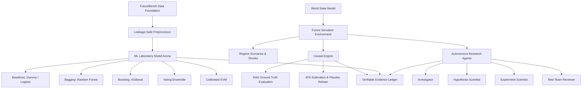

# NEXUS-9 System Architecture

NEXUS-9 is engineered as a research-grade modular AI system designed for industrial foresight, predictive risk anticipation, and causal inference.

## Layer Separation Principles
1. **Evidence Production vs Interpretation**: The ML and simulation engines produce empirical evidence; the autonomous agents interpret, challenge, and explain it.
2. **Anti-Leakage Isolation**: `disruption_risk` is an outcome derived from `delivery_delay_days`, `inventory_gap`, and `service_level`. These columns are strictly blacklisted from early-warning models.
3. **Reproducibility**: Experiments are hashed using SHA-256 and chained into an append-only ledger.
